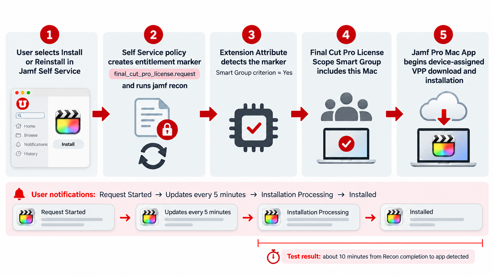

# jamf-mac-app-license-automation

Automation scripts and Jamf Pro configuration guidance for assigning and reclaiming device-based Mac App Store Apps and Books licenses using local entitlement markers, Extension Attributes, and Smart Groups—without endpoint API credentials.

## Purpose

This workflow lets a user request a licensed Mac App from Self Service and later return that license when it is no longer needed. The request script creates or removes a protected, local per-app marker, then runs inventory collection. A corresponding Extension Attribute reports the marker value to Jamf Pro, and a Smart Group uses that result to scope the device-assigned App Store app. Removing the marker takes the computer out of the Smart Group so the license can be reclaimed according to the app’s Jamf Pro configuration.

The scripts make no network calls to Jamf Pro beyond the standard local `jamf recon` command, and they do not require API credentials on the endpoint.

## Scripts

- `jamf_self_service_mac_app_group_membership_request.sh` is the Jamf Pro Self Service policy script. Use it in separate add and remove policies for each app.
- `mac_app_license_marker.sh` is the Extension Attribute script. Create one copy per app and configure its app key before uploading it to Jamf Pro.

## Setup and use

1. For each licensed app, copy `mac_app_license_marker.sh` and set `APP_KEY` to a filename-safe identifier, such as `logic_pro`.
2. Upload that copy as a Jamf Pro Extension Attribute. Create a Smart Group with the Extension Attribute criterion set to an exact value of `Yes`.
3. Upload `jamf_self_service_mac_app_group_membership_request.sh` as a Jamf Pro script, configured to run as root.
4. Create two Self Service policies for the app: one to add the entitlement and one to remove it. In both policies, set script parameter 5 to the exact same `APP_KEY` used by the Extension Attribute.
5. Set parameter 4 to `add` for the request policy and `remove` for the return policy. Parameter 6 optionally enables a dry run (`true` or `false`).
6. Scope the device-assigned Mac App Store app only to the matching Smart Group and select **Install Automatically**. Scope the Self Service policies only to the intended users and computers.

For an add policy, parameter 7 may specify the expected application bundle path (for example, `/Applications/Logic Pro.app`). This enables user notifications while Jamf processes the request. Parameter 8 sets the monitoring limit in seconds (default: `1800`, maximum: `3600`), and parameter 9 enables root-only diagnostic logging when set to `true`.

The add policy creates `/Library/Management/mac_app_group_membership/<app_key>_license.request`; the remove policy deletes it. Each policy runs a recon so the Extension Attribute and Smart Group membership are updated.

## More details

For background, configuration notes, and the full workflow, see the [University of Utah Marriott Library blog post: “Automating Mac App Store License Assignments & Reclamation”](https://apple.lib.utah.edu/automating-mac-app-store-license-assignments-reclamation/).
